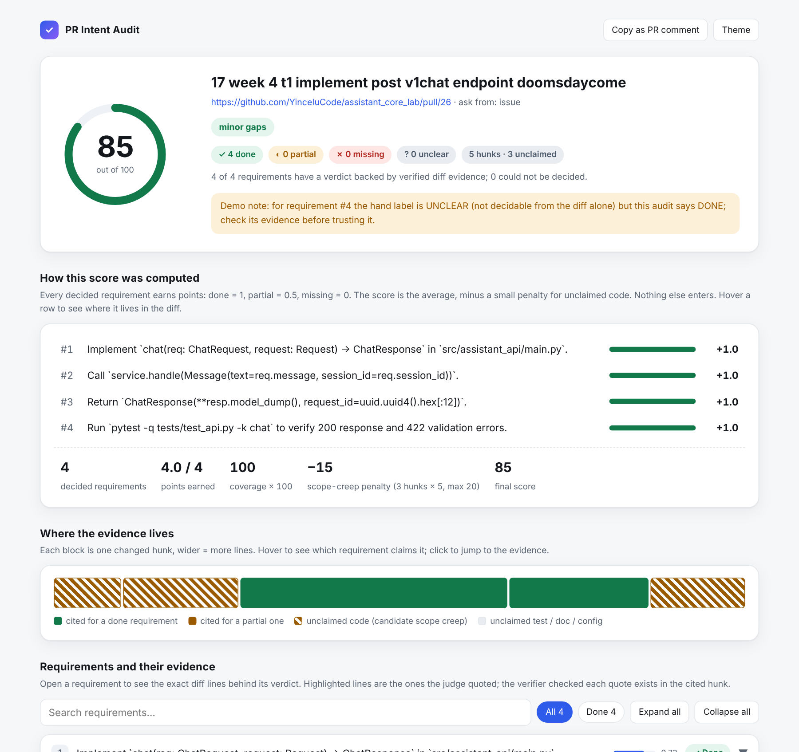
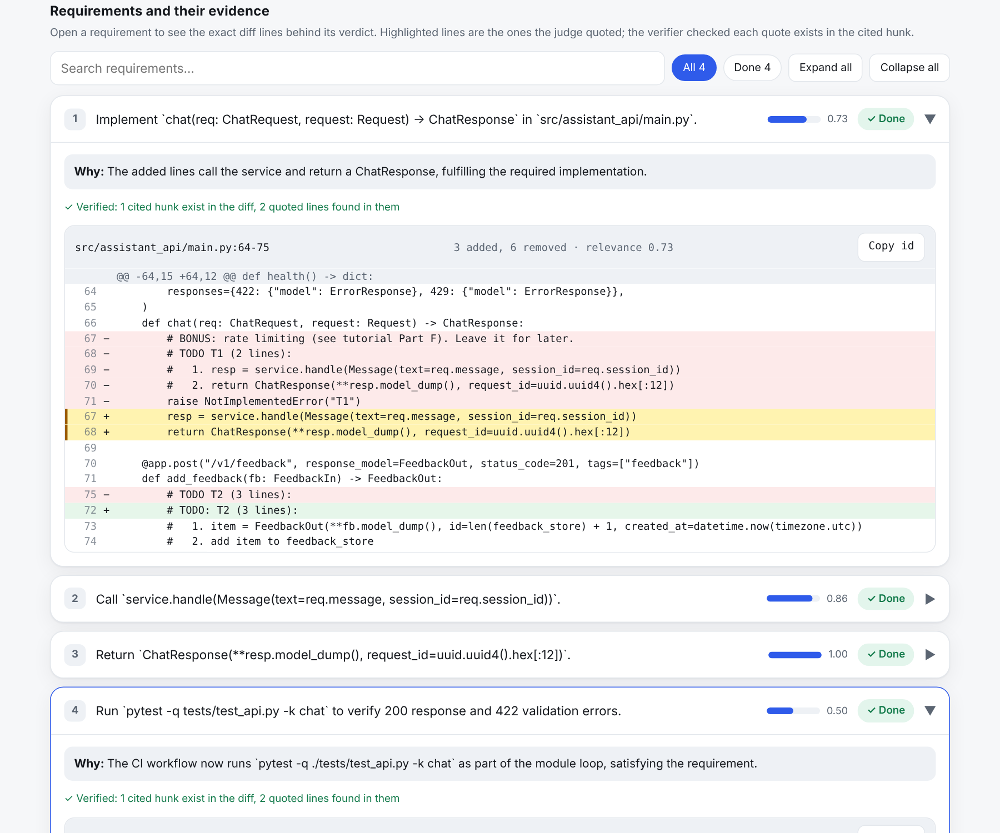

# PR Intent Audit

Did the pull request do what was asked? Especially when a coding agent wrote it.

Give it a PR URL and the ask (the prompt you gave Claude Code or Codex, or the issue/PR body). It splits the ask into
requirements, finds the hunks that address each one, and reports **done / partial / missing / unclear** with evidence
pinned to diff lines, plus hunks that no requirement claims (possible scope creep). It never approves or blocks a merge.

```
# any public PR; --ask-file is optional (use it when the ask is a prompt, not the PR body)
pr-audit run https://github.com/ztrange/veri/pull/2693 --out report.md
```

## How it works

1. **Ingest** the PR through the GitHub API; PR and issue text is treated as untrusted data.
2. **Split** the ask into requirements (rule-based; weak on free-form prose, see below).
3. **Retrieve** candidate hunks per requirement. The default is IDF word overlap (no model files). A CodeBERT cross-encoder
   we trained (`bench/train_relevance.py`) is optional and measured no better (see the retrieval table below).
4. **Judge** each requirement on its top-5 hunks with an LLM (Gemini / Groq free tiers), JSON-only, temperature 0.
5. **Verify** deterministically: every cited hunk must exist and every quoted line must appear in it. Otherwise the
   verdict is downgraded to `unclear`. Evidence in the report is therefore real diff text.

`--local` skips the judge and uses only our trained models. In hybrid mode the PR text is sent to the judge provider;
free Gemini terms allow Google to train on it, so use public repos only.

## Benchmark

Fault injection with labels known by construction, plus a small gold set. Numbers below are generated from
`bench/results/*.json` by `bench/make_results_md.py`; nothing here is typed by hand.

<!-- RESULTS:START -->
Gold set: 14 PRs. Labels were drafted by Claude, approved by the owner without changes, then cross-checked by Claude, who changed 5 (docs/GOLD_CHANGES.md). Single annotator; no second labeller.
Faults: all hunks a requirement points at are removed; controls share no hunks with the fault.

| variant | done precision | done recall | abstained | faults no longer 'done' | 95% CI | faults -> 'missing' | false alarms | judge errors |
|---|---|---|---|---|---|---|---|---|
| ours-only (trained models) | 0.917 | 0.943 | 4 | 3/32 | 0.03-0.24 | 0/32 | 1/26 | n/a |
| hybrid: our top-5 hunks + LLM judge + our verifier | 0.966 | 0.824 | 5 | 21/28 | 0.57-0.87 | 15/28 | 1/19 | 0 |
| hybrid ablation: judge sees all hunks (no retrieval) | 0.963 | 0.839 | 9 | 20/26 | 0.58-0.89 | 16/26 | 2/18 | 0 |
| hybrid ablation: no verifier | 0.97 | 0.821 | 0 | 19/31 | 0.44-0.76 | 15/31 | 1/26 | 0 |
| hybrid ablation: lexical word-overlap retrieval instead of our CodeBERT retriever | 0.963 | 0.812 | 7 | 18/26 | 0.50-0.83 | 10/26 | 1/22 | 0 |

Caveats: faults are injected only where the baseline said 'done', so denominators differ per row;
gold base rate of 'done' is 39/42, so precision must be read against 0.85; judge calls were mostly Groq gpt-oss-120b.

### Large PRs (4 PRs, 13 requirements; labels by Claude, NOT human-reviewed; tiny sample)

| variant | done precision | done recall | abstained | faults no longer 'done' | 95% CI | faults -> 'missing' | false alarms | judge errors | confusion gold x pred [done,partial,missing,unclear] |
|---|---|---|---|---|---|---|---|---|---|
| large PRs (36-98 hunks): top-5 + verifier | 1.0 | 0.778 | 0 | 4/7 | 0.25-0.84 | 2/7 | 2/8 | n/a | {'done': [7, 0, 2, 0], 'partial': [0, 1, 0, 0], 'missing': [0, 0, 3, 0]} |
| large PRs: judge sees all hunks (prompt is length-capped) **(INVALID: 7 judge calls failed, HTTP 413/429)** | 1.0 | 1.0 | 7 | 4/5 | 0.38-0.96 | 2/5 | 0/6 | 7 | {'done': [5, 0, 0, 4], 'partial': [0, 0, 0, 1], 'missing': [0, 0, 1, 2]} |
| large PRs: top-5, no verifier | 1.0 | 0.778 | 0 | 4/7 | 0.25-0.84 | 2/7 | 2/8 | n/a | {'done': [7, 0, 2, 0], 'partial': [0, 1, 0, 0], 'missing': [0, 0, 3, 0]} |

### Retrieval only: is the right hunk in the top k? (124 gold requirements, 35 PRs; no LLM involved)

| retrieval | hit@1 | hit@3 | hit@5 (95% CI) | hit@5 on PRs with 10+ hunks |
|---|---|---|---|---|
| lexical (IDF overlap) | 0.54 | 0.806 | 0.879 [0.81, 0.93] | 0.77 |
| lexical, full hunk text | 0.556 | 0.839 | 0.863 [0.79, 0.91] | 0.721 |
| bm25 | 0.589 | 0.774 | 0.815 [0.74, 0.87] | 0.639 |
| bm25, full hunk text | 0.597 | 0.798 | 0.847 [0.77, 0.9] | 0.689 |
| fusion lexical+bm25 | 0.556 | 0.806 | 0.871 [0.8, 0.92] | 0.754 |
| bm25 + named identifiers/paths (full text) | 0.653 | 0.806 | 0.863 [0.79, 0.91] | 0.721 |
| lexical + named identifiers/paths | 0.605 | 0.815 | 0.879 [0.81, 0.93] | 0.77 |

Random ranking would reach hit@5 = 0.58 overall (most gold PRs are small) and 0.219 on the large ones, so only the large-PR column discriminates, and with n=61 one requirement is 2 points. The large-PR labels were drafted by Claude and are not reviewed by the owner. CodeBERT rows appear only if the last run had torch; no gold PR was in the CodeBERT training set. Variants with identifier boosting use identifiers the requirement names verbatim (backticked names, paths, snake_case/camelCase; weights fixed before looking at results). Differences of a few points are within noise: treat the best variants as candidates, not established gains.
<!-- RESULTS:END -->

## Example report




`docs/demo_report.html` (open it in a browser) is a real audit of a public, MIT-licensed PR, built from saved judge
responses, not a live run. The PR was chosen only because the saved responses cover all its requirements and its repo has
a permissive license. It is not a clean showcase: requirement 4 ("run pytest ...") is judged DONE on weak evidence where the hand
label is UNCLEAR, and 3 scope-creep candidates cost 15 points. The report says so on its first screen. Regenerate it with `python bench/demo_from_cache.py`.

## Cost of one audit

One judge call per requirement. On the 24 gold PRs (median 3 requirements, max 7) an audit is about 4K input tokens
at the median and 14K at the maximum (estimated as characters / 4; `bench/cost_per_pr.py`). At the Groq free tier's
roughly 8K tokens per minute that is under a minute for a typical PR and about two minutes for the largest here.
PRs with long asks (dozens of requirements) will take proportionally longer and can hit the daily limit.

## Audit local work, no PR needed

Pushed straight to `main`, or reviewing what an agent just did? Put the prompt you gave it in a text file and audit the
commits:

```
pr-audit local prompt.txt --base main~3 --head HEAD --retrieval lexical --html report.html
```

`--head ''` audits the uncommitted working tree against `--base`. It uses plain `git diff` (refs are validated; no shell)
and the same retrieval, judge and verifier as a PR audit. Nothing leaves your machine except the hunks sent to the judge.

## Web app

```
pr-audit serve
```

Opens a local app (http://127.0.0.1:8765): paste a PR URL or pick local commits, add the ask, and watch each requirement resolve live (status, reason, cited hunks, judge tokens used). The finished audit opens as the full evidence report in the same page, with Markdown/JSON downloads, a history of past runs, and the saved example report. Runs are stored under `.pr-audit/` (gitignored).

- Standard library only; binds to 127.0.0.1; API calls need the session cookie and a local Host header, so other websites cannot drive your API keys. One audit at a time, to protect the free-tier quota.
- Same pipeline as the CLI (`pipeline.py`): lexical retrieval, LLM judge, verifier. "Wider search" is the experimental `--escalate`; "Show unchanged context" is an untested option (see docs/DECISIONS.md t).
- Checked by 56 Python tests (lifecycle, auth, one-at-a-time, local-repo run with a stub judge) and a headless-DOM UI smoke test (`node tests/ui/smoke.js`, needs `npm install jsdom`). The visual design has not been checked in a real browser by the author yet: if something looks off, open an issue.

## HTML report

`pr-audit run <PR_URL> --retrieval lexical --html report.html` also writes one self-contained HTML file: the score, a
step-by-step breakdown of how it was computed (done = 1, partial = 0.5, missing = 0, minus a capped scope-creep
penalty), a map of which hunks back which requirement, and for every verdict the exact diff lines the judge quoted
(verified to exist in the hunk). No network, no external assets; PR text is rendered as text, never as HTML.

## Where it fails (read this before trusting a number)

- **Our trained models cannot judge a requirement inside one PR.** The relevance model learned to tell whether a hunk
  belongs to a PR, not whether it satisfies a requirement. Alone it catches almost no removed requirements, and its
  "done" precision is no better than always answering "done" (see the base-rate line under the table). Supervising it with commit-message to hunk mappings did not fix this
  (within-PR AUC 0.502). The first version of this project shipped on that model and reported a falsely perfect score.
- **So the judge is an LLM.** Our parts are retrieval, the verifier, and the benchmark. The verifier's benefit over no
  verifier is not statistically established (intervals overlap). Retrieval's accuracy benefit over showing all hunks is
  also not established on small PRs; on large PRs it is needed to fit the free-tier token limit (the all-hunks run hit
  HTTP 413/429 on Groq), which is a cost argument, not an accuracy one.
- **Scope-creep flags are low precision.** On the 14-PR gold set (40 non-test/doc hunks, 7 labelled creep, base rate 0.17),
  flagging at the default threshold (0.5) gives precision 0.25 and recall 1.0; a stricter 0.2 gives 0.42 and 0.71
  (`bench/eval_creep.py`). With 7 positives and the threshold looked at on the same data, treat these as a rough
  guide: the flags are candidates for a human to look at, not findings.
- **The gold set is tiny and single-annotator.** 14 PRs plus a large-PR set (9 PRs now labelled; the LLM tables above cover only the first 4; none of the large set is reviewed by the owner).
  Labels were drafted by Claude; the owner approved the 14-PR draft unchanged, and a later cross-check by Claude
  still found 5 wrong labels (docs/GOLD_CHANGES.md), which shows how weak "approved" is. The judge is also an LLM, so
  errors may be correlated. After the fixes the 14-PR set has no `missing` labels at all.
- **Clean-set precision/recall say little.** After the label fixes the 14-PR set has only 3 requirements that are not
  "done", so "false done" rates there rest on a handful of items. The fault-injection columns (labels known by
  construction) are the main evidence; they cover omissions, not partial implementations.
- **Fault injection undercounts.** Removing the hunks a label points at does not always remove the requirement
  (duplicate files, requirements satisfied elsewhere), so catch rates are likely underestimates by an unknown amount.
- **Requirement splitting is weak.** Checklists work; prose and issue templates produce non-requirements. Measured on
  the gold PRs by `bench/eval_splitter.py` (`bench/results/splitter.json`): about 4 in 5 outputs that gold covers are
  real requirements after the noise rules (72 of 86 outputs), up from about 3 in 4 before. That score is in-sample (the rules,
  including the later ones for definition-of-done templates, environment key/values and emoji "How to reproduce" headings,
  were written after reading those PRs), so expect worse on new PRs. Lists of "possible approaches" are flagged optional and a
  missing option is not counted as a gap.
- **English, public repos only.** Non-English asks are mostly `unclear`. Judging used mostly Groq gpt-oss-120b because
  the Gemini free quota ran out repeatedly.
- **Scope-creep detection is low precision** and has not been validated within a PR.

Design history and every negative result: `docs/DECISIONS.md`.

## GitHub Action (experimental)

`action.yml` + `examples/pr-audit.yml` run the audit on each PR and comment the report. It needs no model files
(lexical retrieval) but needs a free Groq or Gemini key as a repo secret. **It has not been run on a live PR yet.**
Each run also uploads the full HTML report (score breakdown + evidence viewer) as a workflow artifact named
`pr-intent-audit-report`. Fork PRs get no secrets, so they are skipped.

## Train the models yourself

The trained weights are not in this repo (`models/` is gitignored); the data is mined from public PRs on your own
machine with your own `GITHUB_TOKEN`. A 4 GB GPU (RTX 3050) is enough. Mining and training are resumable.

```
pip install -r bench\requirements-train.txt
python bench\mine.py                 # merged public PRs that close an issue -> bench/data/bundles.jsonl
python bench\mine_deepen.py          # more PRs from the same repos (hard negatives)
python bench\mine_commits.py         # commit -> hunk supervision (did not help within-PR, kept for the record)
python bench\mine_gold.py            # acceptance-criteria PRs for the gold pool
python bench\train_relevance.py      # CodeBERT cross-encoder -> models/relevance
python bench\train_verdict.py        # verdict + scope-creep classifiers -> models/verdict.joblib
```

Without `models/`, use lexical retrieval (the default quick start): `pr-audit run <PR_URL> --retrieval lexical`. It needs a free Groq or Gemini key in `.env`. Whether lexical retrieval matches the CodeBERT retriever is not established yet: the comparison runs were invalid (judge errors) and are not reported.

## License

MIT, see `LICENSE`. Benchmark data is derived from public GitHub PRs; it is mined locally and not redistributed here
except short requirement excerpts and hunk ids in `bench/gold/`.

License status of that data (`bench/license_audit.py`, `bench/results/licenses.json`): 16 of the 28 repos behind the gold PRs
have a permissive license (MIT, Apache-2.0, BSD); 12 have none, an unrecognised one, or GPL. The excerpts are short and no
code is redistributed in `bench/gold/`, but the 12 should be treated as a known gap. New mining (`bench/mine_large.py`) keeps
only permissive repos, and the published demo report uses one.

## Reproduce

```
python -m venv .venv && .venv\Scripts\activate && pip install -e .[dev]
copy .env.example .env      # add GEMINI_API_KEY and/or GROQ_API_KEY, GITHUB_TOKEN
python bench\eval_gold.py                 # ours-only
python bench\eval_gold_llm.py             # hybrid; add: all | noverify | large
python bench\make_results_md.py           # regenerates docs/RESULTS.md and the table above
pytest
```
